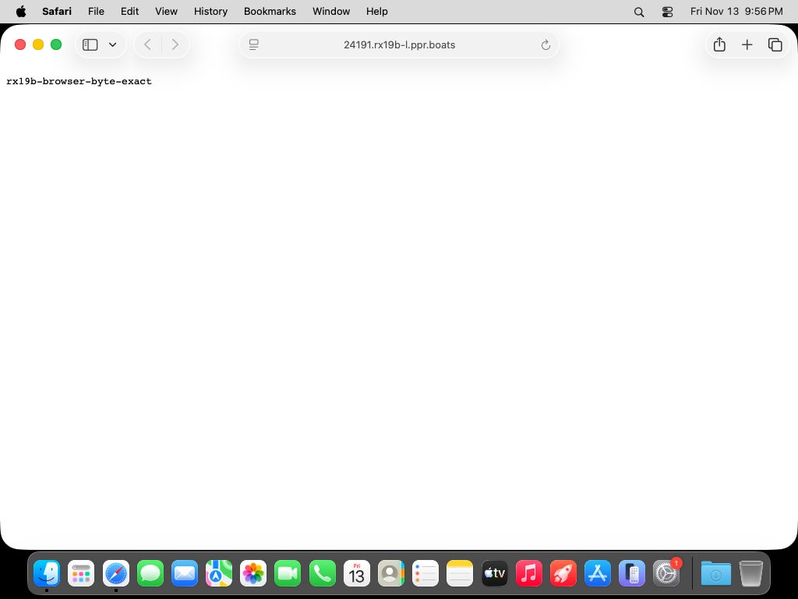
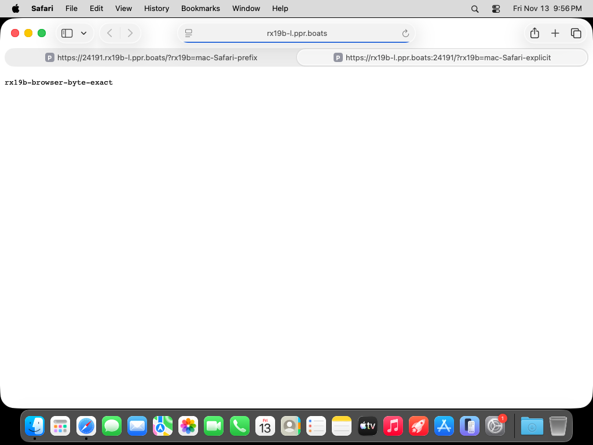
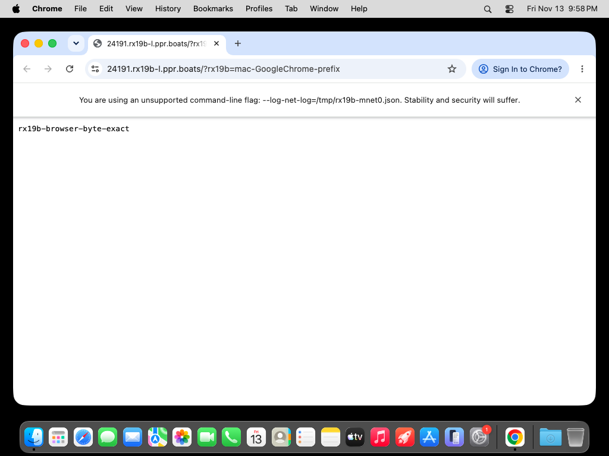
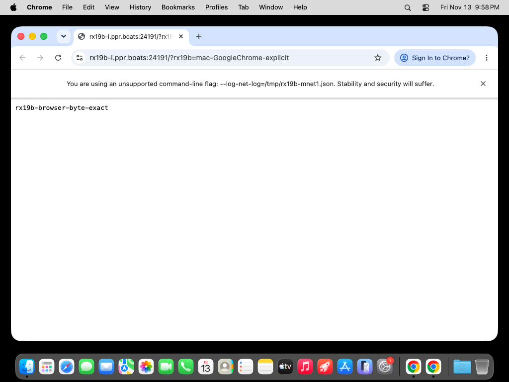
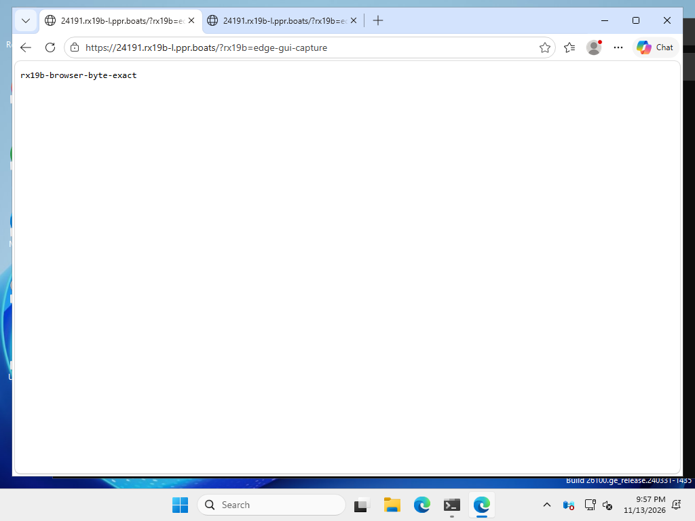

# X-19: macOS and Windows, R-X-19-B, 2026-11-13 UTC

| Part | macOS | Windows |
| --- | --- | --- |
| Doctor: actual DNS rebind filter, assigned-IP access, restore | PASS | PASS |
| Browser: Secure DNS, both HTTPS URL forms, OS CA store | PASS (Chrome + Safari) | PASS (Edge) |

Build: `dev-ac409910b`, commit `ac409910b`. Only the supplied binaries were installed, with their own `pb install`.
Own machines: macpool-4, winpool-6, container rx19b-l on pbvm2; one fresh throwaway account.
No shared fleet or apple changes. CHECKLIST is left to the parent.

## Rebinding resolver
The following stdlib UDP resolver actually forwards to 1.1.1.1 and returns NXDOMAIN for private/loopback A answers; it does not drop DNS traffic.

```python
import socket,struct,ipaddress,time
s=socket.socket(socket.AF_INET,socket.SOCK_DGRAM);s.bind(('127.0.0.1',53));s.settimeout(1)
def name(b,p):
 while b[p]:
  if b[p]&192==192:return p+2
  p+=b[p]+1
 return p+1
end=time.monotonic()+900
while time.monotonic()<end:
 try:
  q,a=s.recvfrom(4096)
 except socket.timeout:continue
 try:
  u=socket.socket(socket.AF_INET,socket.SOCK_DGRAM);u.settimeout(4);u.sendto(q,('1.1.1.1',53));r=u.recv(4096);u.close()
  p=12
  for _ in range(struct.unpack('!H',r[4:6])[0]):p=name(r,p)+4
  qe=p;blocked=False
  for _ in range(struct.unpack('!H',r[6:8])[0]):
   p=name(r,p);t,c,ttl,n=struct.unpack('!HHIH',r[p:p+10]);p+=10
   if t==1 and n==4:
    ip=ipaddress.ip_address(r[p:p+4]);blocked|=ip.is_private or ip.is_loopback
   p+=n
  if blocked:
   r=r[:2]+struct.pack('!H',(struct.unpack('!H',r[2:4])[0]&0xfff0)|3)+r[4:6]+b'\0'*6+r[12:qe]
   print('REBINDFILTER NXDOMAIN private A',flush=True)
  s.sendto(r,a)
 except Exception as e:print(type(e).__name__,flush=True)
```

macOS: `networksetup -setdnsservers Ethernet 127.0.0.1`, `dscacheutil -flushcache`, `killall -HUP mDNSResponder`.
Detached 300-second restoration job started before changing DNS; original Ethernet DNS setting was Empty (DHCP), restored with `networksetup -setdnsservers Ethernet Empty`.
Windows: `Set-DnsClientServerAddress -InterfaceIndex 14 -ServerAddresses 127.0.0.1`; `ipconfig /flushdns`.
Original adapter addresses and whether static/DHCP saved before modification; detached scheduled restoration task armed for 300 seconds.
Restoration used `-ResetServerAddresses` for the original DHCP configuration (168.63.129.16), then flushed DNS and removed tasks.

Verbatim outputs below select the local_names check from `pb doctor --json`, without changing its text.
`pb resolve rx19b-l --json` supplies assigned_ip; Python asserts both forwarded and assigned-IP response bytes.

## macOS doctor and access

```text
### version
      ▄█▄       Paperboat
  ▄▄▝▀▀▀▀▀▘▄▄   Version dev-ac409910b
   ▀███████▀


### resolve
{"machine_id":"machine_5187be94-67b2-4ea5-bae8-0c387f89cf96","alias":"rx19b-l","assigned_ip":"127.100.0.2","forwarded_ports":[24191,38693],"browser_urls":{"24191":"https://24191.rx19b-l.ppr.boats","38693":"https://38693.rx19b-l.ppr.boats"}}

baseline [{"category": "local", "code": "local_names", "status": "pass", "summary": "Local browser names resolve to this computer."}]
DNS before Ethernet There aren't any DNS Servers set on Ethernet.

### enable filter

filtered [{"category": "local", "code": "local_names", "status": "warning", "summary": "Your DNS resolver blocks private answers (DNS rebinding protection), so names under ppr.boats do not resolve here.", "recovery": "Allow ppr.boats in your router or Pi-hole, or use the machine's 127.100.x.y address (`pb resolve <machine>`) with `pb access machine`. Machine access with pb does not use these names."}]

### curl filtered
curl: (6) Could not resolve host: 24191.rx19b-l.ppr.boats


### assigned IP byte exact
b'rx19b-browser-byte-exact\n'


### explicit access under filter
/Users/runner/.local/bin/pb access machine rx19b-l --port 24191 --listen 127.0.0.1:24192
http://127.0.0.1:24192/ b'rx19b-browser-byte-exact\n'
http://127.100.0.2:24191/ b'rx19b-browser-byte-exact\n'


### restore

restored [{"category": "local", "code": "local_names", "status": "pass", "summary": "Local browser names resolve to this computer."}]

### DNS after
There aren't any DNS Servers set on Ethernet.
```

## Windows doctor and access

```text
PB C:\Program Files\Paperboat\users\ue655ce475da61ffc2e916d1d\bin\pb.exe

### version
      ▄█▄       Paperboat
  ▄▄▝▀▀▀▀▀▘▄▄   Version dev-ac409910b
   ▀███████▀


### resolve
{"machine_id":"machine_5187be94-67b2-4ea5-bae8-0c387f89cf96","alias":"rx19b-l","assigned_ip":"127.100.0.2","forwarded_ports":[24191,38693],"browser_urls":{"24191":"https://24191.rx19b-l.ppr.boats","38693":"https://38693.rx19b-l.ppr.boats"}}

baseline [{"category": "local", "code": "local_names", "status": "pass", "summary": "Local browser names resolve to this computer."}]

### enable real rebind filter

Windows IP Configuration

Successfully flushed the DNS Resolver Cache.
filtered [{"category": "local", "code": "local_names", "status": "warning", "summary": "Your DNS resolver blocks private answers (DNS rebinding protection), so names under ppr.boats do not resolve here.", "recovery": "Allow ppr.boats in your router or Pi-hole, or use the machine's 127.100.x.y address (`pb resolve <machine>`) with `pb access machine`. Machine access with pb does not use these names."}]

### curl filtered
curl: (6) Could not resolve host: 24191.rx19b-l.ppr.boats


### direct assigned IP byte exact
b'rx19b-browser-byte-exact\n'


### explicit access under filter
C:\Program Files\Paperboat\users\ue655ce475da61ffc2e916d1d\bin\pb.exe access machine rx19b-l --port 24191 --listen 127.0.0.1:24192
http://127.0.0.1:24192/ b'rx19b-browser-byte-exact\n'
http://127.100.0.2:24191/ b'rx19b-browser-byte-exact\n'


### restore DNS now

Windows IP Configuration

Successfully flushed the DNS Resolver Cache.
restored [{"category": "local", "code": "local_names", "status": "pass", "summary": "Local browser names resolve to this computer."}]
```

## Browsers and OS trust

No certificate bypass flag was used. The fresh profiles use the CA installed by pb into the OS trust store.
`curl`/`curl.exe -sS --max-time 25 https://24191.rx19b-l.ppr.boats/` returned `rx19b-browser-byte-exact` on both OSes without `-k`.
Both URL forms use the Linux HTTP origin at 127.0.0.1:24191. The persistent private policy for this target was created from Windows; the duplicate Mac allow returned policy_changed, and the existing policy served both browsers successfully.
macOS browser commands: `open -a Safari <URL>` and `open -na 'Google Chrome' --args --user-data-dir=/tmp/rx19b-chromeN --no-first-run --log-net-log=/tmp/rx19b-mnetN.json --net-log-capture-mode=Everything <URL>`.
Chrome's initial downloaded-app Open prompt was accepted using System Events/CoreServicesUIAgent. No pb local-network prompt appeared (no UserNotificationCenter window).
Windows: scheduled task launches Edge as runneradmin, with a temporary profile and --log-net-log. GUI screenshot taken from an explicit Interactive-logon scheduled PowerShell task (SSH-session CopyFromScreen was black and excluded).
Both Chromium browsers' fresh profile `Local State` contains:
```json
{"dns_over_https":{"mode":"secure","templates":"https://cloudflare-dns.com/dns-query"}}
```











Edge DOM fallback, verbatim (also corroborated by interactive GUI screenshot):

```text
https://24191.rx19b-l.ppr.boats/?rx19b=edge-dom-prefix
<html><head><meta name="color-scheme" content="light dark"></head><body><pre style="word-wrap: break-word; white-space: pre-wrap;">rx19b-browser-byte-exact
</pre></body></html>

[7004:9200:1113/215615.101:ERROR:components\optimization_guide\core\model_execution\performance_class.cc:111] Edge LLM: Not supported on non Desktop SKU
[7004:9200:1113/215616.143:ERROR:chrome\browser\task_manager\providers\fallback_task_provider.cc:126] Every renderer should have at least one task provided by a primary task provider. If a "Renderer" fallback task is shown, it is a bug. If you have repro steps, please file a new bug and tag it as a dependency of crbug.com/40528867.

https://rx19b-l.ppr.boats:24191/?rx19b=edge-dom-explicit
<html><head><meta name="color-scheme" content="light dark"></head><body><pre style="word-wrap: break-word; white-space: pre-wrap;">rx19b-browser-byte-exact
</pre></body></html>

[6936:1696:1113/215627.899:ERROR:components\optimization_guide\core\model_execution\performance_class.cc:111] Edge LLM: Not supported on non Desktop SKU
[6936:1696:1113/215628.979:ERROR:chrome\browser\task_manager\providers\fallback_task_provider.cc:126] Every renderer should have at least one task provided by a primary task provider. If a "Renderer" fallback task is shown, it is a bug. If you have repro steps, please file a new bug and tag it as a dependency of crbug.com/40528867.
```

### rx19b-net0.json selected verbatim net events

```text
DNS_CONFIG_CHANGED {"allow_dns_over_https_upgrade": true, "append_to_multi_label_name": false, "attempts": 2, "can_use_insecure_dns_transactions": true, "can_use_secure_dns_transactions": true, "dns_over_tls_active": false, "dns_over_tls_hostname": "", "doh_attempts": 1, "doh_config": {"servers": [{"template": "https://cloudflare-dns.com/dns-query"}]}, "fallback_doh_nameservers": [], "nameservers": ["168.63.129.16:53"], "ndots": 1, "num_hosts": 5, "rotate": false, "search": ["g5py524myvxelcvquwn3ibsm3c.dx.internal.cloudapp.net"], "secure_dns_mode": 2, "should_perform_doh_fallback_upgrade": false, "timeout": 1, "unhandled_options": false, "use_local_ipv6": false}
URL_REQUEST_START_JOB {"initiator": "not an origin", "load_flags": 208, "method": "POST", "network_isolation_key": "null null (dns over https)", "request_type": "other", "site_for_cookies": "SiteForCookies: {site=null; schemefully_same=false}", "upload_id": "0", "url": "https://cloudflare-dns.com/dns-query"}
HOST_RESOLVER_MANAGER_JOB {"dns_query_types": ["A", "HTTPS"], "host": "https://24191.rx19b-l.ppr.boats", "network_anonymization_key": "https://ppr.boats same_site", "secure_dns_mode": 2, "source_dependency": {"id": 176, "type": 35}, "tasks": [2]}
HOST_RESOLVER_DNS_TASK_EXTRACTION_RESULTS {"results": [{"domain_name": "24191.rx19b-l.ppr.boats", "endpoints": [{"address": "127.100.0.1", "port": 0}], "hosts": [], "query_type": "A", "source": "dns", "strings": [], "timed_expiration": "13439080570678326", "type": "data"}]}
```

### rx19b-net1.json selected verbatim net events

```text
DNS_CONFIG_CHANGED {"allow_dns_over_https_upgrade": true, "append_to_multi_label_name": false, "attempts": 2, "can_use_insecure_dns_transactions": true, "can_use_secure_dns_transactions": true, "dns_over_tls_active": false, "dns_over_tls_hostname": "", "doh_attempts": 1, "doh_config": {"servers": [{"template": "https://cloudflare-dns.com/dns-query"}]}, "fallback_doh_nameservers": [], "nameservers": ["168.63.129.16:53"], "ndots": 1, "num_hosts": 5, "rotate": false, "search": ["g5py524myvxelcvquwn3ibsm3c.dx.internal.cloudapp.net"], "secure_dns_mode": 2, "should_perform_doh_fallback_upgrade": false, "timeout": 1, "unhandled_options": false, "use_local_ipv6": false}
URL_REQUEST_START_JOB {"initiator": "not an origin", "load_flags": 208, "method": "POST", "network_isolation_key": "null null (dns over https)", "request_type": "other", "site_for_cookies": "SiteForCookies: {site=null; schemefully_same=false}", "upload_id": "0", "url": "https://cloudflare-dns.com/dns-query"}
HOST_RESOLVER_MANAGER_JOB {"dns_query_types": ["A", "HTTPS"], "host": "https://rx19b-l.ppr.boats:24191", "network_anonymization_key": "https://ppr.boats same_site", "secure_dns_mode": 2, "source_dependency": {"id": 239, "type": 35}, "tasks": [2]}
HOST_RESOLVER_DNS_TASK_EXTRACTION_RESULTS {"results": [{"domain_name": "rx19b-l.ppr.boats", "endpoints": [{"address": "127.100.0.1", "port": 0}], "hosts": [], "query_type": "A", "source": "dns", "strings": [], "timed_expiration": "13439080608268165", "type": "data"}]}
```

### rx19b-mnet0.json selected verbatim net events

```text
DNS_CONFIG_CHANGED {"allow_dns_over_https_upgrade": true, "append_to_multi_label_name": true, "attempts": 2, "can_use_insecure_dns_transactions": true, "can_use_secure_dns_transactions": true, "dns_over_tls_active": false, "dns_over_tls_hostname": "", "doh_attempts": 1, "doh_config": {"servers": [{"template": "https://cloudflare-dns.com/dns-query"}]}, "fallback_doh_nameservers": [], "nameservers": ["192.168.64.1:53"], "ndots": 1, "num_hosts": 5, "rotate": false, "search": [], "secure_dns_mode": 2, "should_perform_doh_fallback_upgrade": false, "timeout": 1, "unhandled_options": false, "use_local_ipv6": false}
HOST_RESOLVER_MANAGER_JOB {"dns_query_types": ["A", "HTTPS"], "host": "https://24191.rx19b-l.ppr.boats", "network_anonymization_key": "https://ppr.boats same_site", "secure_dns_mode": 2, "source_dependency": {"id": 60, "type": 35}, "tasks": [2]}
URL_REQUEST_START_JOB {"initiator": "not an origin", "load_flags": 208, "method": "POST", "network_isolation_key": "null null (dns over https)", "request_type": "other", "site_for_cookies": "SiteForCookies: {site=null; schemefully_same=false}", "upload_id": "0", "url": "https://cloudflare-dns.com/dns-query"}
HOST_RESOLVER_DNS_TASK_EXTRACTION_RESULTS {"results": [{"domain_name": "24191.rx19b-l.ppr.boats", "endpoints": [{"address": "127.100.0.1", "port": 0}], "hosts": [], "query_type": "A", "source": "dns", "strings": [], "timed_expiration": "13439080741437601", "type": "data"}]}
```

### rx19b-mnet1.json selected verbatim net events

```text
DNS_CONFIG_CHANGED {"allow_dns_over_https_upgrade": true, "append_to_multi_label_name": true, "attempts": 2, "can_use_insecure_dns_transactions": true, "can_use_secure_dns_transactions": true, "dns_over_tls_active": false, "dns_over_tls_hostname": "", "doh_attempts": 1, "doh_config": {"servers": [{"template": "https://cloudflare-dns.com/dns-query"}]}, "fallback_doh_nameservers": [], "nameservers": ["192.168.64.1:53"], "ndots": 1, "num_hosts": 5, "rotate": false, "search": [], "secure_dns_mode": 2, "should_perform_doh_fallback_upgrade": false, "timeout": 1, "unhandled_options": false, "use_local_ipv6": false}
HOST_RESOLVER_MANAGER_JOB {"dns_query_types": ["A", "HTTPS"], "host": "https://rx19b-l.ppr.boats:24191", "network_anonymization_key": "https://ppr.boats same_site", "secure_dns_mode": 2, "source_dependency": {"id": 60, "type": 35}, "tasks": [2]}
URL_REQUEST_START_JOB {"initiator": "not an origin", "load_flags": 208, "method": "POST", "network_isolation_key": "null null (dns over https)", "request_type": "other", "site_for_cookies": "SiteForCookies: {site=null; schemefully_same=false}", "upload_id": "0", "url": "https://cloudflare-dns.com/dns-query"}
HOST_RESOLVER_DNS_TASK_EXTRACTION_RESULTS {"results": [{"domain_name": "rx19b-l.ppr.boats", "endpoints": [{"address": "127.100.0.1", "port": 0}], "hosts": [], "query_type": "A", "source": "dns", "strings": [], "timed_expiration": "13439080775790786", "type": "data"}]}
```

## Linux origin request log

```text
127.0.0.1 - - [13/Nov/2026 21:53:05] "GET / HTTP/1.1" 200 -
127.0.0.1 - - [13/Nov/2026 21:54:18] "GET / HTTP/1.1" 200 -
127.0.0.1 - - [13/Nov/2026 21:54:53] "GET / HTTP/1.1" 200 -
127.0.0.1 - - [13/Nov/2026 21:55:12] "GET /?rx19b=edge-port-prefix HTTP/1.1" 200 -
127.0.0.1 - - [13/Nov/2026 21:55:14] "GET /favicon.ico HTTP/1.1" 200 -
127.0.0.1 - - [13/Nov/2026 21:55:22] "GET / HTTP/1.1" 200 -
127.0.0.1 - - [13/Nov/2026 21:55:45] "GET / HTTP/1.1" 200 -
127.0.0.1 - - [13/Nov/2026 21:55:50] "GET /?rx19b=edge-explicit-port HTTP/1.1" 200 -
127.0.0.1 - - [13/Nov/2026 21:55:51] "GET /favicon.ico HTTP/1.1" 200 -
127.0.0.1 - - [13/Nov/2026 21:55:59] "GET /?rx19b=mac-Safari-prefix HTTP/1.1" 200 -
127.0.0.1 - - [13/Nov/2026 21:56:00] "GET /favicon.ico HTTP/1.1" 200 -
127.0.0.1 - - [13/Nov/2026 21:56:17] "GET /?rx19b=edge-dom-prefix HTTP/1.1" 200 -
127.0.0.1 - - [13/Nov/2026 21:56:20] "GET /?rx19b=mac-Safari-explicit HTTP/1.1" 200 -
127.0.0.1 - - [13/Nov/2026 21:56:22] "GET /favicon.ico HTTP/1.1" 200 -
127.0.0.1 - - [13/Nov/2026 21:56:30] "GET /?rx19b=edge-dom-explicit HTTP/1.1" 200 -
127.0.0.1 - - [13/Nov/2026 21:56:55] "GET /?rx19b=edge-gui-capture HTTP/1.1" 200 -
127.0.0.1 - - [13/Nov/2026 21:56:57] "GET /favicon.ico HTTP/1.1" 200 -
127.0.0.1 - - [13/Nov/2026 21:58:03] "GET /?rx19b=mac-GoogleChrome-prefix HTTP/1.1" 200 -
127.0.0.1 - - [13/Nov/2026 21:58:06] "GET /favicon.ico HTTP/1.1" 200 -
127.0.0.1 - - [13/Nov/2026 21:58:38] "GET /?rx19b=mac-GoogleChrome-explicit HTTP/1.1" 200 -
127.0.0.1 - - [13/Nov/2026 21:58:40] "GET /favicon.ico HTTP/1.1" 200 -
127.0.0.1 - - [13/Nov/2026 21:59:03] "GET / HTTP/1.1" 200 -
127.0.0.1 - - [13/Nov/2026 21:59:12] "GET / HTTP/1.1" 200 -
127.0.0.1 - - [13/Nov/2026 21:59:13] "GET / HTTP/1.1" 200 -
127.0.0.1 - - [13/Nov/2026 21:59:15] "GET / HTTP/1.1" 200 -
127.0.0.1 - - [13/Nov/2026 21:59:23] "GET / HTTP/1.1" 200 -
127.0.0.1 - - [13/Nov/2026 21:59:24] "GET / HTTP/1.1" 200 -
```

## Cleanup

```text
Linux version:       ▄█▄       Paperboat
  ▄▄▝▀▀▀▀▀▘▄▄   Version dev-ac409910b
   ▀███████▀

Windows DNS restored: [{"InterfaceAlias":"Ethernet 3","ServerAddresses":["168.63.129.16"]},{"InterfaceAlias":"Loopback Pseudo-Interface 1","ServerAddresses":[]},{"InterfaceAlias":"vEthernet (nat)","ServerAddresses":[]}]

macOS DNS restored: There aren't any DNS Servers set on Ethernet.

revoke exact rx19b-m machine_dda69e50-11ca-4571-8e30-7c7cdd62e21e rc 0
revoke exact rx19b-w machine_07b4d317-15e3-4fec-bd12-c81475adba39 rc 0
revoke exact rx19b-l machine_5187be94-67b2-4ea5-bae8-0c387f89cf96 rc 0
uninstalled rx19b-m
uninstalled rx19b-w
uninstalled rx19b-l
CPU usage: 20.0% user, 41.42% sys, 38.57% idle
CPU usage: 0.97% user, 2.28% sys, 96.73% idle
```

No product change or unit-test run was needed. No Go build/vet/test was run on oracle.

Final cleanup: `macpool-4 released`; `winpool-6 stopping`; `docker rm -f rx19b-l` returned `rx19b-l`; `fresh account deleted`. Only the released, idle Mac remains running for reuse; no pb installation or test process remains on it. Local account credentials and raw browser logs removed after evidence extraction.
